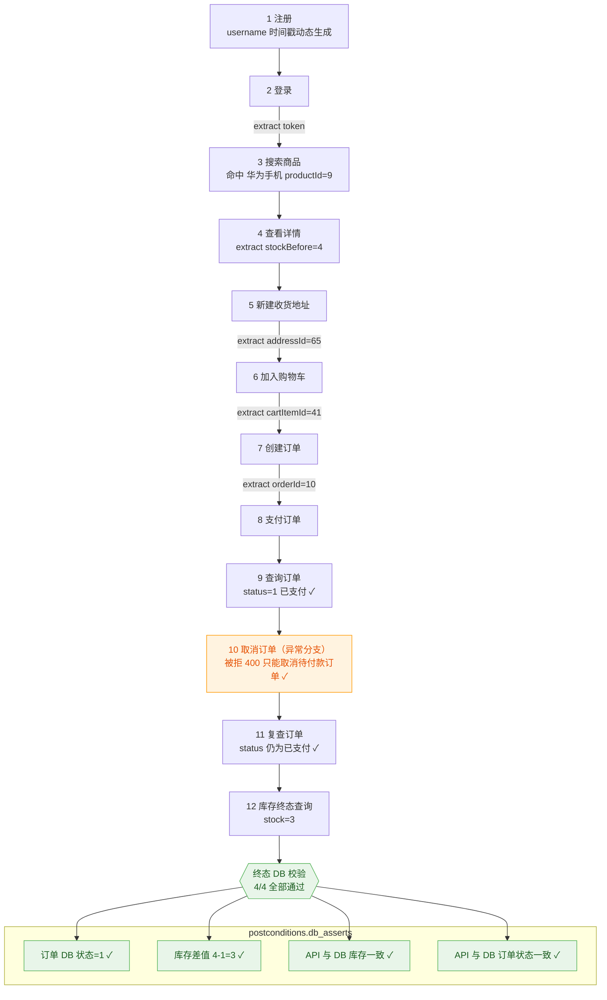

# AI 测试实战系列 22｜业务场景·链路执行：api-scenario-runner

> AI 测试实战系列（共 22 篇）｜ 01 用例设计（接口/UI 通用） · 接口自动化 02-10 · UI 自动化 11-20 · 业务场景 21-22 ｜ 本文第 22 篇 · 业务场景线收官

---

> **导读**：上一篇 api-scenario-modeler 把业务场景翻译成了 `scenario_xxx.yaml` 编排文件——测什么，已经定义好了。**这份文件怎么真实跑起来？跑挂了怎么定位？能不能进 CI 流水线天天跑？**
>
> 本篇拆解「怎么跑」的执行机器 **api-scenario-runner**：run 模式本地调试链路秒级反馈，compile 模式一键编译成 pytest 脚本，并入前面篇章建立的执行调度、失败诊断、报告生成体系。一份数据，两种消费。

## 一、它是什么？

**api-scenario-runner 是业务场景接口测试的执行引擎**，把 api-scenario-modeler（或人工）产出的 `scenario_xxx.yaml` 编排文件真实执行起来：

- 按序发请求
- 自动变量提取与注入
- 鉴权头注入
- 三级断言（步骤断言 + db 终态断言）
- 每步执行快照留存
- 失败即停保留现场
- 支持把编排文件编译为 pytest 链路脚本工程

**擅长**：

- 本地调试链路秒级反馈
- 批量回归交给流水线天天跑
- 失败定位有完整快照，不用人肉回溯

**亮点**：一份数据两种消费；支持连数据库做终态校验——订单状态、库存扣减对不对，直接查库确认，**不是只看接口返回**。

## 二、适用场景

- 执行场景编排文件、跑链路、端到端流程验证
- 把场景 yaml 编译成 pytest 链路脚本，纳入 api-test-executor（第 06 篇）统一调度
- 失败后保留完整现场，交给 api-failure-diagnoser（第 07 篇）深度诊断

**使用方式**：在 Claude Code 中提供编排文件路径，或输入：

```
/api-scenario-runner
```

## 三、两种执行模式

| 模式 | 说明 |
| --- | --- |
| **run**（默认） | 直接执行：结构校验 → 按序请求 → 三级断言 → 报告 + 快照 |
| **compile** | 编译为 pytest 工程：`testcases/test_scenario_<id>.py` + `data/scenario_<id>.yaml`，复用被测项目 utils/config |

两种模式对应两种用法：**本地调试用 run**，改完编排马上跑，秒级反馈；**批量回归用 compile**，编译成 pytest 脚本后交给流水线天天跑。

## 四、核心能力

- **场景上下文**：`${var}` 自动提取与注入（支持整串替换与拼接），`auth: true` 步骤自动注入 Bearer token
- **三级断言**：步骤断言（status_code → 业务码 → jsonpath）→ 终态 db 断言（expect_value 直接比对 / expect_expr 变量表达式求值）
- **失败即停 + 现场留存**：每步快照写入 `steps_snapshot.json`（注入后真实请求、响应、变量视图，敏感值脱敏）
- **归因初判五类**：VARIABLE_MISSING / ASSERTION_FAILED / API_ERROR / CONNECTION_ERROR / DB_ERROR
- **安全机制**：db 断言仅允许 SELECT、SQL 参数化执行、编排文件禁止写死连接信息、配置缺失 fail-fast

**输出**：`scenario_report.md`（执行报告）+ `steps_snapshot.json`（诊断快照）+ compile 产物（pytest 工程）。

## 五、实测：run 模式跑通一条购物主链路

拿第 21 篇产出的 `scenario_shopping_flow.yaml`（SC-order-001，12 步链路 + 4 条终态 DB 断言）直接执行。


执行过程中，runner 会自行对比与修正各接口字段名称：


数据库数据一致性校验：


执行完成，SC-order-001 全链路通过，整条链路的实际执行效果：




同时，`scenario_shopping_flow.yaml` 和 `modeling_notes.md` 这两份场景资产已同步为实测最新版：


最后，还会自动生成一份 md 格式的场景测试执行报告（默认存放在接口测试项目目录 `/shop-lab-api-test/scenario_run_results/xxx/scenario_report.md`）：


## 六、compile：编译成 pytest，融入既有体系

run 模式适合本地调试，批量回归则要把编排文件编译成 pytest 脚本，并入前面篇章建立的自动化体系：

```
/api-scenario-runner 编译场景编排文件 /Users/xxx/scenarios/scenario_order_flow.yaml 为 pytest 脚本，输出到 shop-lab-api-test 项目
```


编译产物检查两点：

1. 目录结构符合第 04 篇的分层规范（`testcases/` + `data/`）；
2. 如上图所示，在 `testcases/` 目录下，生成了 pytest 链路脚本 `test_scenario_order_001.py`：


在 `data/` 目录下，生成业务场景关联脚本测试数据 `scenario_order_001.yaml`：


之后的一切都是熟悉的：用第 06 篇的 `api-test-executor` 按标签（scene:business-flow）调度执行，或交给第 10 篇的 `api-pipeline-scheduler` 纳入「执行 → 清理 → 报告」流水线。

比如输入如下提示词：

```bash
调用api-test-executor技能，跑一下~/ai_project/shop-lab-api-test/testcases/test_scenario_order_001.py这个业务场景测试脚本
```

执行后，链路 14 步 + 终态 DB 校验 4 条全部通过，期间还顺手修复了一个编译器的 Bug。


执行完成后，顺带调用第 09 篇的 api-report-generator 技能，让其生成测试报告：


会自动生成好两份测试报告，一份是基于 Allure 原生报告（在线服务）：


另一份，是自研定制的 HTML 测试报告（单文件，可独立打开）：


## 七、最后一关：幂等与重复执行

还有一类问题最隐蔽：**昨天能跑今天跑不过**。验证方法非常简单粗暴——**不做任何修改，紧接着再执行一遍同一条链路**。


合格标准非常明确：**第二遍同样全绿**。因为 username 是 timestamp 策略动态生成的，第二遍注册的是新用户，不存在第 06 篇 `newuser_001` 那种重复注册冲突；链路数据回收按 cleanup 配置联动第 08 篇的 `api-testdata-cleaner`，两遍执行之间环境是干净的。如果第二遍失败，大概率暴露两类问题——唯一性字段漏了动态策略，或 cleanup 配置漏了某个数据对象，回编排文件即可。


这一关直接决定链路能不能进 CI 流水线天天跑，是最不能省的一关。


## 八、如何获取和安装？

api-scenario-runner 已经开源，Skill 商店地址 https://www.testfather.cn/skills，GitHub 仓库如下，

```bash
git clone https://github.com/zhoujinjian/skills.git
```

**安装到 WorkBuddy**：

```bash
cp -r skills/api-scenario-runner ~/.workbuddy/skills/
```

**安装到 Claude Code**：

```bash
cp -r skills/api-scenario-runner ~/.claude/skills/
```

> **小贴士**：api-scenario-runner 的编排文件来自 api-scenario-modeler（第 21 篇）；失败快照可交给 api-failure-diagnoser（第 07 篇）深度诊断，数据回收联动 api-testdata-cleaner（第 08 篇）。

## 写在最后

至此，业务场景测试完全并入前面篇章建立的自动化体系——**单接口与业务场景两条线，在同一个体系里跑了起来。**

回顾这两篇构成的完整闭环：

| 环节 | Skill | 产出 |
| --- | --- | --- |
| 测什么 | **api-scenario-modeler**（第 21 篇） | scenario yaml 编排文件 + modeling_notes.md |
| 怎么跑 | **api-scenario-runner**（本篇） | run 直跑报告 + 快照；compile 编译 pytest 工程 |
| 挂了修 | api-failure-diagnoser（第 07 篇） | 消费 steps_snapshot.json 深度诊断 |
| 数据收 | api-testdata-cleaner（第 08 篇） | 按 cleanup 配置回收链路数据 |
| 天天跑 | api-test-executor / api-pipeline-scheduler（第 06 / 10 篇） | 标签调度、流水线编排 |

从第 01 篇的用例设计四件套，到 02-10 接口自动化、11-20 UI 自动化，再到 21-22 业务场景串联——用例设计、脚本生成、执行运营、报告决策、业务链路，AI 赋能测试全流程的实战拼图，到这里全部凑齐了。

---

**配套资源**

- Skill 工具包下载，https://www.testfather.cn/skills（星球成员已含网站会员，登录直接领）
- 完整开发设计教程与项目源码（含 30+ AI 测试全场景 Agent Skill），见「狂师 . AI 进化社」

**系列导航**（AI 测试实战系列，共 22 篇）

测前设计（接口 / UI 通用）

- [01 用例设计四件套](./01-testcase-design-toolkit.md)，generator-testcase-xmind / excel · safe-testcase · review-testcase

接口自动化 · 脚本开发

- [02 文档智能解析](./02-api-schema-parser.md)，api-schema-parser
- [03 测试数据构造](./03-api-testdata-generator.md)，api-testdata-generator
- [04 脚本批量生成](./04-api-testscript-generator.md)，api-testscript-generator
- [05 脚本质量优化](./05-api-test-optimizer.md)，api-test-optimizer

接口自动化 · 执行运营

- [06 智能执行调度](./06-api-test-executor.md)，api-test-executor
- [07 失败自动诊断修复](./07-api-failure-diagnoser.md)，api-failure-diagnoser
- [08 测试数据清理](./08-api-testdata-cleaner.md)，api-testdata-cleaner
- [09 测试报告生成](./09-api-report-generator.md)，api-report-generator
- [10 全链路流水线编排](./10-api-pipeline-scheduler.md)，api-pipeline-scheduler

UI 自动化 · 脚本开发

- [11 页面解析](./11-ui-page-parser.md)，ui-page-parser
- [12 脚本批量生成](./12-ui-testscript-generator.md)，ui-testscript-generator
- [13 脚本健壮性增强](./13-ui-testscript-enhancer.md)，ui-testscript-enhancer
- [14 视觉断言与多浏览器适配](./14-ui-visual-assert.md)，ui-visual-assert
- [19 脚本生成流水线串联](./19-ui-script-pipeline.md)，4+1 Skill 实战

UI 自动化 · 执行运营

- [15 智能执行调度](./15-ui-test-executor.md)，ui-test-executor
- [16 失败自动诊断修复](./16-ui-failure-diagnoser.md)，ui-failure-diagnoser
- [17 测试报告生成](./17-ui-report-generator.md)，ui-report-generator
- [18 全链路流水线编排](./18-ui-pipeline-scheduler.md)，ui-pipeline-scheduler
- [20 执行到报告全流程串联](./20-ui-full-flow-integration.md)，4+1 Skill 架构收官

业务场景 · 接口串联

- [21 业务场景建模](./21-api-scenario-modeler.md)，api-scenario-modeler
- [22 业务场景链路执行](./22-api-scenario-runner.md)，api-scenario-runner（业务场景线完结）
